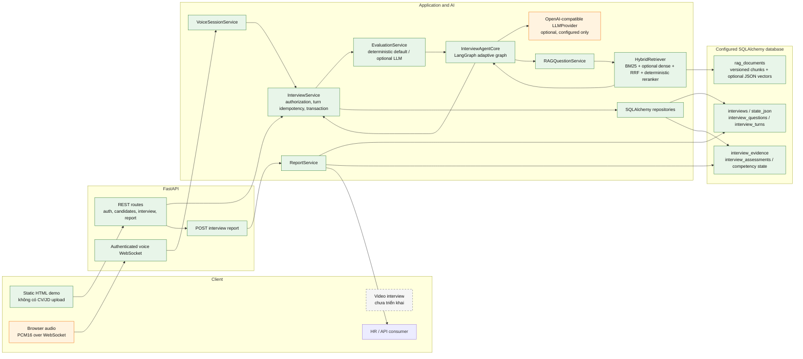
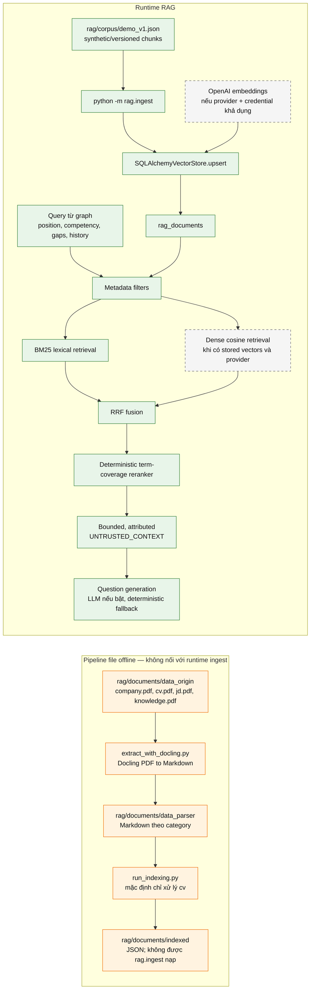
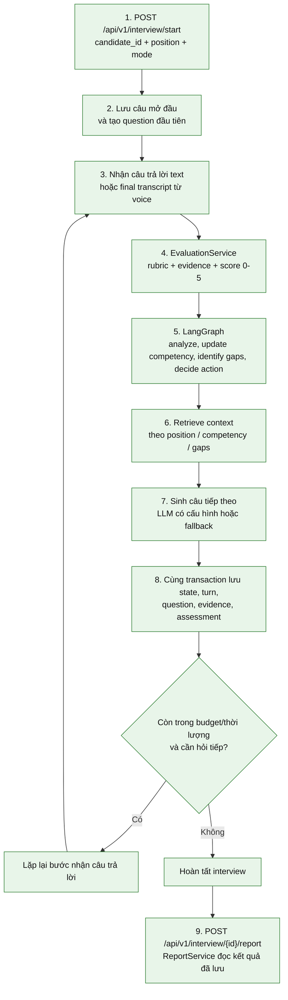

# AI Interview — kiến trúc đã xác minh

> Diagram này mô tả source hiện có, không biến các ý tưởng trong README/architecture thành
> tính năng đã triển khai. Các audit phase cũ có nhận định mâu thuẫn với source hiện tại;
> trạng thái dưới đây ưu tiên implementation và test trực tiếp.

## Trạng thái

- **Đã triển khai:** endpoint phỏng vấn có xác thực; interview service và transaction SQLAlchemy;
  adaptive LangGraph; lưu question/turn/evidence/assessment; báo cáo JSON/TXT; hybrid RAG truy
  vấn bảng `rag_documents`; WebSocket voice.
- **Một phần / tùy cấu hình:** OpenAI LLM và embeddings; voice provider AssemblyAI/ElevenLabs;
  PDF parsing và indexing offline. Mặc định hiện tại lần lượt là `LLM_PROVIDER=none`,
  thiếu embedding key sẽ retrieval lexical-only, voice dùng fake providers.
- **Chưa được nối vào runtime:** PDF `data_origin` và kết quả `data_parser`/`indexed` không được
  `rag.ingest` đọc. Runtime ingest hiện tại nhận corpus JSON demo.
- **Mục tiêu thiết kế, chưa có bằng chứng implementation:** nhận JD/CV làm ngữ cảnh interview,
  dùng company PDF trong retrieval, cố định 10 câu hỏi, pass khi đạt ít nhất 3/5 câu.
- **Chưa triển khai:** video interview; giao diện sản phẩm React/HR hoàn chỉnh.

## Luồng tổng thể

### Ranh giới thực tế của nguồn RAG

`data_origin` tồn tại; riêng `company/company.pdf` và ba PDF `cv.pdf`, `jd.pdf`,
`knowledge.pdf` đã được xác minh qua danh sách file. `data_parser/company/` cũng có 10 file
Markdown. Tuy vậy, `rag/ingest.py` gọi `load_demo_corpus()` trên
`rag/corpus/demo_v1.json`, không đọc PDF, Markdown đã parse hay JSON trong `indexed`. `run_indexing.py`
hiện có điều kiện bỏ qua mọi category ngoài `cv`; đầu ra JSON của script cũng không được gọi bởi
`rag.ingest`. Do đó chưa có bằng chứng `company.pdf` đang tham gia retrieval của ứng dụng. Nội dung
PDF không được trích xuất/đọc trong khảo sát này; kết luận chỉ về sự tồn tại file và code path.

## Trình tự một phiên phỏng vấn

## Ý nghĩa với yêu cầu AI Interview

- **JD/CV:** `POST /api/v1/interview/start` chỉ nhận `candidate_id`, `position`, `mode`;
  Candidate API có `resume_url` nhưng không có upload/parse/attach CV hoặc JD vào interview.
  Graph hiện tạo plan competency mặc định, không xây interview plan từ tài liệu ứng viên.
- **Sinh câu hỏi:** graph có routing adaptive (`DIG_DEEPER`, đổi competency, tăng/giảm độ khó,
  `FINISH`) và sinh câu hỏi theo RAG context. LLM dùng được nếu cấu hình; câu mở đầu và fallback
  vẫn deterministic. Không có bảo đảm tạo đúng 10 câu.
- **Thu câu trả lời:** text answer đi qua REST; voice final transcript được chuyển thành
  `InterviewService.submit_answer()` với `utterance_id` làm turn ID. Partial transcript chỉ phát
  cho UI, không lưu. Voice hiện mặc định fake; có adapter STT/TTS tùy chọn. Video chưa có luồng.
- **Đánh giá/lưu:** hiện có rubric abstraction, evaluator deterministic mặc định và LLMEvaluator
  tùy provider. Turn answer, evidence, assessment, competency state và question được lưu; answer
  text từ STT là nội dung turn, chưa có bản ghi transcript/audio riêng.
- **HR report:** API xuất JSON/TXT và tổng hợp điểm/evidence/gaps/recommendation. `ReportService`
  hiện không đưa danh sách câu hỏi và câu trả lời theo từng turn vào payload report, dù turn và
  question được lưu riêng.
- **Mâu thuẫn nghiệp vụ cần chủ sản phẩm quyết định:** yêu cầu đang nêu 10 câu nhưng pass là ít
  nhất 3/5 câu. Cấu hình hiện tại mặc định `DEFAULT_NUM_QUESTIONS = 8`; graph có budget/thời lượng
  và điều kiện competency score tối thiểu 3 cho các competency trong plan, không phải điều kiện
  pass 3/5 câu. Chưa tự chọn cách diễn giải.

## File code/test trọng tâm

| Đường dẫn | Vai trò đã xác minh |
|---|---|
| `apps/api/main.py` | Khởi tạo FastAPI, mount REST và WebSocket routers |
| `apps/api/v1/routes/interview.py` | Start/answer/read/list/report; dùng authenticated user |
| `apps/api/v1/routes/candidate.py` | CRUD candidate; `resume_url` là trường tham chiếu, không upload |
| `apps/api/websocket/interview.py` | Authenticated voice WebSocket, JSON và binary audio |
| `services/interview_service.py` | Điều phối interview, evaluator, graph, retrieval, turn lock/idempotency |
| `services/repositories.py` | Lưu interview/question/turn/evidence/assessment qua SQLAlchemy |
| `services/database.py` | SQLAlchemy models, gồm interview và `rag_documents` |
| `agents/interview_agent/graph/__init__.py` | LangGraph state, routing, question generation và fallback |
| `evaluation/service.py` | Evidence/rubric/score, deterministic và LLM evaluator |
| `integrations/llm_providers/provider.py` | Optional OpenAI-compatible LLM và structured output |
| `rag/service.py` | BM25, dense retrieval, RRF, reranker, SQLAlchemy vector store, context builder |
| `rag/ingest.py`, `rag/corpus_loader.py` | Nạp demo JSON vào `rag_documents` |
| `rag/chunking/extract_with_docling.py` | Pipeline PDF → Markdown trong `data_parser` |
| `rag/chunking/run_indexing.py` | Index Markdown thành JSON; hiện chỉ chạy category `cv` |
| `voice/session.py`, `voice/real_providers.py` | Audio session/STT/TTS orchestration và provider adapters |
| `services/report_service.py` | Tổng hợp kết quả đã lưu, xuất JSON/TXT |
| `tests/unit/test_adaptive_graph.py`, `test_evaluation_domain.py` | Test graph và evaluation/persistence |
| `tests/unit/test_rag_semantic_retrieval.py`, `test_voice_websocket.py`, `test_report_service.py` | Test retrieval, voice endpoint và report |

## Khoảng trống trước khi triển khai yêu cầu

1. Chốt business contract về số câu, “3/5” là câu hỏi hay competency, điều kiện kết thúc và score
   threshold; hiện default là 8 và hành vi khác tiêu chí mục tiêu.
2. Bổ sung input/association có kiểm soát cho JD và CV; parse, chunk, metadata/version, rồi nối
   outputs `data_parser`/`indexed` vào pipeline ingest runtime thay vì chỉ ingest corpus demo.
3. Xác nhận `company.pdf` là nguồn company knowledge cần dùng; ingest có attribution và metadata
   scope phù hợp, rồi kiểm chứng company chunks thực sự nằm trong `rag_documents` và được retrieval
   trong interview. Hiện file tồn tại nhưng chưa được `rag.ingest` dùng.
4. Quyết định rubric theo JD/competency và nối rubric/context đã truy xuất vào evaluation; hiện
   service tạo rubric mặc định theo competency.
5. Bổ sung Q&A/transcript theo từng turn vào báo cáo HR; giữ distinction giữa partial transcript
   không lưu và final answer/transcript đã persist.
6. Nếu yêu cầu đa phương thức là bắt buộc, xác minh live provider/config STT/TTS; VAD hiện fake,
   voice default fake, và video chưa có implementation.
7. Thêm integration/evaluation tests cho dữ liệu JD/CV/company thực, retrieval quality theo nguồn,
   policy 10 câu/pass đã chốt và report Q&A; live LLM/provider hiện chưa được xác minh.
